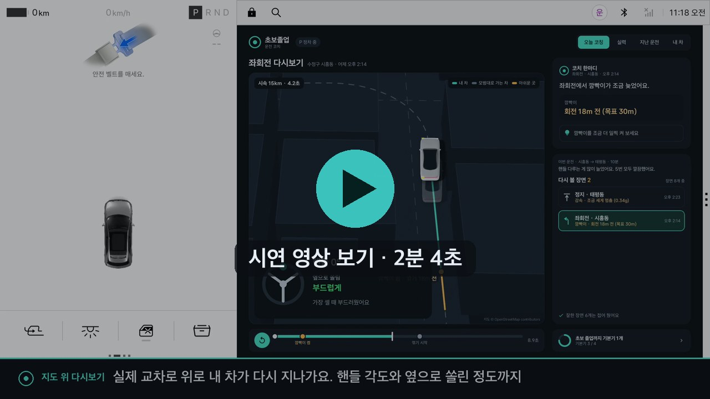
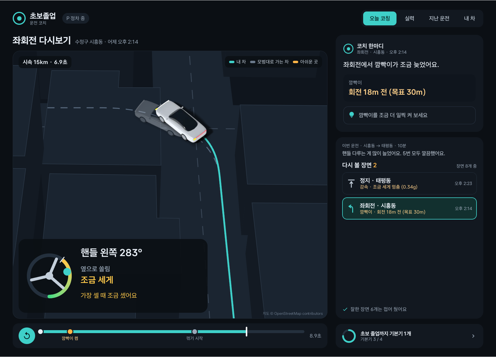
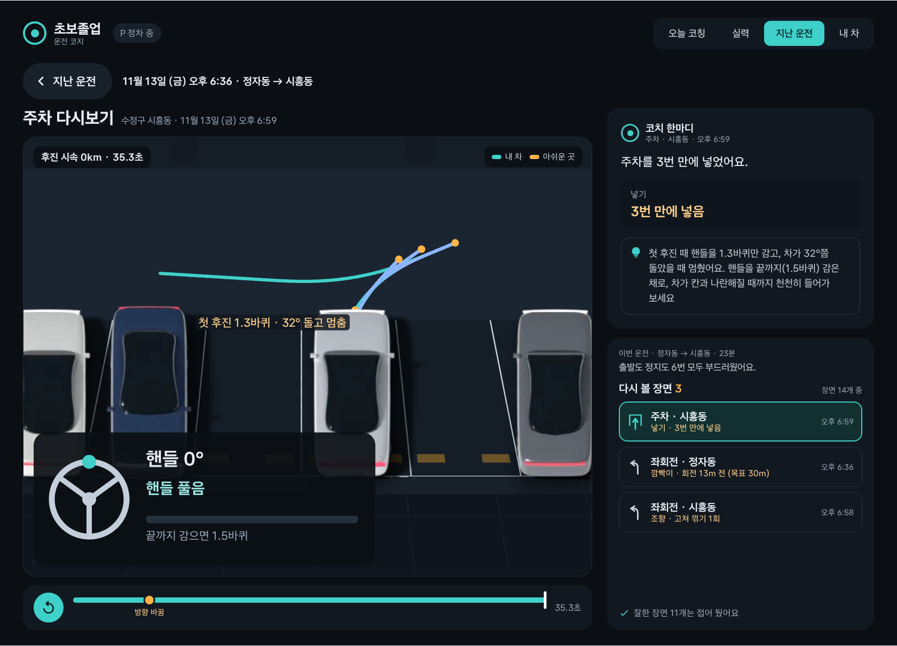
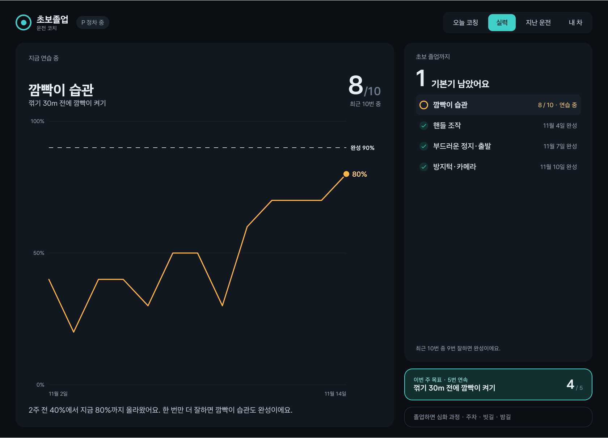
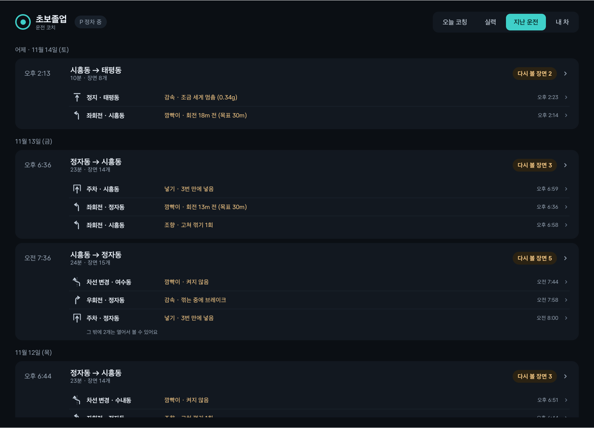
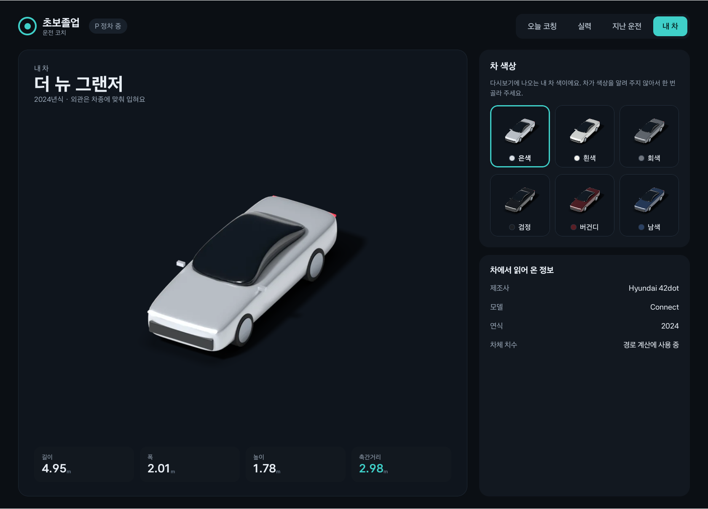

# 초보졸업

[](docs/%EC%B4%88%EB%B3%B4%EC%A1%B8%EC%97%85_%EC%8B%9C%EC%97%B0%EC%98%81%EC%83%81.mp4)

<sub>음악: "Super Friendly" Kevin MacLeod (incompetech.com) · <a href="https://creativecommons.org/licenses/by/4.0/">CC BY 4.0</a></sub>

**차가 알려 주는 깜빡이·핸들·기어·브레이크 신호로 운전을 장면마다 돌아보고, 아쉬웠던 장면만 실제 지도 위에서 내 차로 다시 보여 주는 차 안의 AI 운전 코치입니다.** 기본기 네 가지가 몸에 붙으면 초보를 졸업합니다.

현대자동차그룹 차량용 앱 개발 공모전 출품작 · Pleos Connect(AAOS) 앱



## 무엇을 하나요

- **장면별 자동 판정**: 좌·우회전, 유턴, 차선 변경, 정지·출발, 과속방지턱·단속 카메라·어린이 보호구역·철길 건널목, 주차, 미끄러질 뻔한 순간을 차 신호로 잘라 판정합니다. 사용자는 아무것도 누르지 않습니다.
- **운전 중엔 화면 대신 소리와 앰비언트 라이트**: 이번 주 과제를 잘하면 짧은 효과음과 실내 불빛으로 알려 줍니다.
- **P에 두면 오늘 코칭**: 다시 볼 장면만 골라 보여 주고, 잘한 장면은 접어 둡니다. 장면마다 코치 한마디가 붙습니다.
- **지도 위 다시보기**: 실제 교차로의 도로·건물 위로 내 차(차종·크기는 차에서 읽음)가 실제 시간대로 지나가고, 모범대로 가는 반투명 차가 함께 갑니다. 깜빡이·브레이크등·후진등도 그때 신호대로 켜지고, 왼쪽 아래에 핸들 각도와 쏠림(g)이 나옵니다. 여러 번 만에 넣은 주차는 첫 후진에서 핸들을 얼마나 감았고 차가 얼마나 돌았는지 짚어, 핸들을 어떻게 했어야 하는지 알려 줍니다.
- **기본기와 졸업**: 깜빡이·핸들·정지/출발·방지턱/카메라 네 가지를 최근 10번 중 9번 잘하면 완성, 모두 완성하면 초보 졸업. 졸업 뒤엔 주차·빗길·밤길 심화 과정으로 이어집니다.

| 주차 다시보기 | 실력 |
|---|---|
|  |  |

| 지난 운전 | 내 차 |
|---|---|
|  |  |

## APK

- **위치**: 저장소의 [`apk/정태휘_초보졸업_release.apk`](apk/) (release 빌드, 약 48MB). 같은 파일을 [Releases](../../releases/latest)에도 `JeongTaehwi_chobo-graduate_release.apk`로 올려 두었습니다(Releases는 한글 파일 이름을 지원하지 않습니다).
- 별도 서명 키 없이 설치할 수 있도록 디버그 키로 서명했고, 심사용 ‘시연 기록 넣기’ 명령이 동작하도록 시연 도구(`BuildConfig.DEMO_TOOLS`)를 켜 두었습니다.

## 시연 영상

- `docs/초보졸업_시연영상.mp4` (2분 4초): 앱 둘러보기 → Virtual Console로 실시간 주행 → 초보 졸업 → 방금 주행 다시보기

## 테스트 환경

| 항목 | 값 |
|---|---|
| 에뮬레이터 | Pleos Connect 에뮬레이터 v2.1.0 (Android 14, API 34, arm64) + Virtual Console |
| 실행 사용자 | 운전자 사용자 `--user 10` |
| 화면 | 2560×1440 (앱 창은 차량 패널 옆 약 1680dp 폭) |
| Pleos Playground SDK | Vehicle 2.3.2, NaviHelper 3.0.5 |
| 빌드 | JDK 17, AGP 8.8.2, Kotlin 2.0, compileSdk 35, minSdk 28 |

## 실행 방법

### 1. 설치

Pleos Connect 에뮬레이터를 켠 뒤:

```bash
adb install -r -g apk/정태휘_초보졸업_release.apk
adb shell am start --user 10 -n dev.driveform/.ui.MainActivity
```

`-g`로 설치하면 위치·알림 권한이 한 번에 허용됩니다. 차량 권한(`pleos.car.permission.*`, `android.car.permission.CAR_SPEED`·`CAR_INFO`)은 매니페스트에 선언되어 있습니다.

처음 열면 ‘시작하기’를 한 번 누르면 됩니다. 회원가입이나 설정은 없습니다.

### 2. 시연 기록 넣기 (심사용)

실제로 2주를 운전하지 않아도 화면을 볼 수 있도록, 2주 치 출퇴근 기록을 넣는 명령이 있습니다. 대본대로 만든 차량 신호를 실제 판정 엔진에 그대로 흘려 만든 기록입니다. 차가 P에 있을 때만 동작합니다.

```bash
adb shell am broadcast --user 10 -a dev.driveform.DEMO_SEED -p dev.driveform
```

| 옵션 | 화면 |
|---|---|
| (없음) | 2주 기록. 깜빡이 하나만 남아 졸업 직전 |
| `--es mode graduate` | 졸업 직전 기록 + 깜빡이를 미리 켠 짧은 주행 → 졸업 축하 장면 |
| `--es mode badge` | 졸업 + 주차 심화 배지 |
| `--es mode start` | 기록은 두고 시작 화면부터 |
| `--es mode restore` | 시연 전의 실제 기록으로 되돌리기 |

### 3. Virtual Console로 직접 운전해 보기

Virtual Console에서 기어 D → 속도를 올리고 → 깜빡이를 켠 뒤 핸들을 돌려 회전 → 기어 P. P에 두면 방금 운전의 다시 볼 장면이 ‘오늘 코칭’에 나옵니다. 내비 알림(방지턱·카메라 등)은 다음 명령으로 흉내 낼 수 있습니다.

```bash
adb shell am broadcast --user 10 -a dev.driveform.DEMO_ROAD -p dev.driveform --es kind camera --ei distance 150 --ei limit 50
```

## 직접 빌드

```bash
./gradlew assembleRelease      # app/build/outputs/apk/release/app-release.apk
./gradlew testDebugUnitTest    # 단위 테스트 82개
```

Pleos Playground SDK는 `settings.gradle.kts`에 적힌 공개 저장소(`nexus-playground.pleos.ai`)에서 받습니다. Android SDK 경로는 `local.properties`의 `sdk.dir`로 지정합니다.

## 구조

```
app/src/main/java/dev/driveform/
├─ vehicle/   차량 신호 구독(Vehicle SDK·NaviHelper·CarPropertyManager), 앰비언트 라이트·효과음
├─ form/      판정 엔진: 장면 자르기(MoveDetector), 폼 채점(MoveForm), 경로 계산(DrivePath),
│             기본기·졸업(Graduation), 코치 문장(Coaching), 지도 맞추기(MapScene), 시연 기록(DemoHistory)
└─ ui/        Compose 화면: 오늘 코칭·실력·지난 운전·내 차(CoachApp), 지도 다시보기(MapReplay), 축하(Celebration)
app/src/main/assets/
├─ car/       미리 렌더링한 차 이미지(색 6가지 × 10°마다 36장, 깜빡이·브레이크등·후진등 층)
└─ demo_map.json  시연 교차로의 도로·건물(OpenStreetMap)
```

- 경로는 GPS가 아니라 속도와 핸들 각도로 계산합니다(자전거 모델). 회전 하나, 주차 하나를 그리기에 GPS 오차가 크기 때문입니다.
- 기록은 기기 안에만 저장하고 외부 서버로 보내지 않습니다.

## 출처

- 지도 데이터: © OpenStreetMap contributors (ODbL)
- 시연 영상 배경음악: "Super Friendly" Kevin MacLeod (incompetech.com), Licensed under [Creative Commons: By Attribution 4.0](https://creativecommons.org/licenses/by/4.0/)
- 기준값: 깜빡이 30m는 도로교통법 시행령 별표 2, 빗길 20% 감속은 도로교통법 시행규칙 제19조
